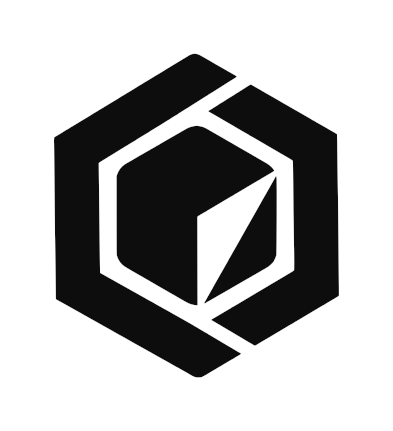

<h3>César D. Velandia</h3>
 

I work across **security, architecture and developer tooling**, from system design and team workflows down to the tools themselves. Lately that means **AI agents** and the **MCP servers** they call: what they can reach, who approved it, and how they fit into a team's workflow. I write tools in [Rust](https://github.com/cdvel?tab=repositories&q=&type=&language=rust&sort=) and Go.

I learn in public, keep a [tech radar][tech-radar] of what I'm exploring, and write on [my site][website]. Always happy to work with people on open source projects.

### Get in touch

[][website]
[][twitter]
[][linkedin]
[][instagram]

[tech-radar]: https://cesar.velandia.co/notes/tech-radar/
[website]: https://cesar.velandia.co
[twitter]: https://x.com/cdvel
[instagram]: https://instagram.com/cdvel
[linkedin]: https://linkedin.com/in/cdvelandia

  

